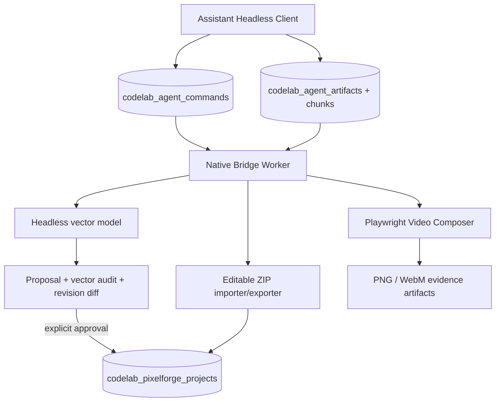

# CodeLab — arquitectura Neon y persistencia de proyectos

Este archivo es el resumen de arquitectura de persistencia. La especificación técnica detallada y el diagrama de comunicación se mantienen en [CodeLab ↔ Neon: comunicación técnica extremo a extremo](CodeLab_Neon_comunicacion_extremo_a_extremo.md).

## Principios

- Neon PostgreSQL es la fuente de verdad de cuentas, órdenes, proyectos persistentes, revisiones, resultados y metadatos de evidencia.
- El navegador puede mantener caché/estado temporal, pero no sustituye la persistencia del servidor.
- Los proyectos PixelForge y sus animaciones se guardan como documentos editables asociados a workspace, revisión y hash.
- Los vídeos e imágenes son evidencia de inspección; no son la fuente canónica del proyecto.
- Cloudflare/R2 o almacenamiento S3-compatible guarda bytes de evidencia cuando está configurado; Neon conserva las referencias y metadata.
- GitHub versiona el software y ejecuta CI; no es el transporte normal de cada edición de proyecto.

## Entorno de producción y límites de persistencia

La topología de producción verificada para CodeLab es:

- **Aplicación:** servicio web Render `codelab`, en el workspace `Xsuperwarriorx`, desplegado desde el repositorio `gavilandavid89-pixel/CodeLab` y la rama `main`. Render realiza el despliegue automático de los commits de esa rama.
- **Base de datos:** proyecto Neon `Codelab`, rama `production`. La conexión de la aplicación se configura mediante `DATABASE_URL`; nunca documentar aquí el valor ni credenciales.
- **Separación de entornos:** el contenedor PostgreSQL de los workflows de integración es efímero y aislado. Un fallo de un test E2E contra ese contenedor no demuestra por sí solo una caída, corrupción o problema de cuota de la base Neon de producción.
- **Disco de Render:** `CODELAB_DATA_DIR` no está configurado en el servicio auditado. El directorio local por defecto queda en el filesystem efímero del servicio; no debe tratarse como almacenamiento duradero. Los logs del servidor indican que sesiones y proyectos del workspace se guardan en PostgreSQL. Los archivos locales de desarrollo y el secreto local de respaldo no sobreviven necesariamente a un redeploy. Todo dato que deba persistir debe usar Neon o el almacenamiento de objetos configurado.

### Inventario de tablas observado en Neon

La inspección de solo lectura de la rama `production` encontró estas 16 tablas públicas. El inventario se agrupa por responsabilidad; las migraciones siguen siendo la fuente de verdad de columnas, índices y restricciones.

| Área | Tablas |
|---|---|
| Identidad y workspace | `codelab_accounts`, `codelab_auth_sessions`, `codelab_workspace_states` |
| Buzón y puente de agentes | `codelab_agent_commands`, `codelab_agent_bridge_state`, `codelab_agent_artifacts`, `codelab_agent_artifact_chunks` |
| PixelForge | `codelab_pixelforge_projects`, `codelab_pixelforge_change_events`, `codelab_pixelforge_project_uploads`, `codelab_pixelforge_project_upload_chunks` |
| Archivos e importaciones | `codelab_project_artifacts`, `codelab_project_files`, `codelab_project_import_requests`, `codelab_project_imports`, `codelab_project_registry` |

El inventario confirma que las estructuras existen en producción; no sustituye las pruebas de lectura/escritura funcionales ni autoriza a usar datos reales como fixtures. Las pruebas deben crear y limpiar sus propios datos en un entorno aislado, sin ejecutar limpieza sobre la rama de producción.

## Comunicación y activación del worker

El servidor `server.js` mantiene un pool PostgreSQL y un cliente dedicado `pg.Client` con `LISTEN codelab_agent_bridge_wake`. Un trigger AFTER INSERT/UPDATE de una orden a estado `queued` emite `pg_notify`. El listener arranca `agent-bridge-worker.mjs` bajo demanda si no está activo.

El worker tiene su propio pool SQL y su propio cliente dedicado LISTEN. Reclama órdenes de la tabla durable con transacciones y `FOR UPDATE SKIP LOCKED`. Cuando la cola queda vacía, espera una notificación; **no ejecuta polling de 150 ms ni un cron de keep-alive**. La notificación despierta; la fila SQL es la fuente durable.

Ambos listeners convierten el hostname Neon pooled a endpoint directo cuando detectan `-pooler.`, porque mantienen conexiones estables LISTEN/NOTIFY. Los pools de consultas normales pueden seguir usando el endpoint configurado en `DATABASE_URL`. El servidor y el worker usan `CODELAB_DATABASE_SSL` con TLS habilitado por defecto. Si Neon no acepta la conexión inicial, el listener del servidor programa reintentos exponenciales de hasta 60 segundos y vuelve a reconciliar la cola cuando conecta.

## Proyectos y animación

Las modificaciones persistentes deben seguir el flujo:

`editor/API → validación → Neon project JSONB → server_revision + 1 → content_sha256`.

Las escrituras críticas verifican la revisión esperada y usan locks por workspace. Un conflicto de revisión debe devolverse como conflicto, no sobrescribir el proyecto.

Para dibujo/animación:
- conservar frames, cels, capas, timings y metadatos dentro del documento persistente;
- validar los datos raster/vectoriales antes de exportar;
- generar PNG/vídeo como evidencia cuando corresponda;
- relacionar cada evidencia con proyecto, revisión y event_id;
- inspeccionar realmente el vídeo/captura antes de afirmar que la animación se ve correcta.

## Recuperación y límites

NOTIFY puede perderse si se produce antes de que LISTEN esté activo; por eso el servidor consulta órdenes queued no expiradas al terminar de armar el listener. El worker también vuelve a consultar la cola al reconectar. Las órdenes tienen expiración, heartbeat durante ejecución y recuperación limitada de filas running abandonadas.

El polling de 150 ms fue retirado. La transferencia todavía puede ser alta si se consultan snapshots con payload/result grandes, proyectos con Base64 o vídeos/imágenes. Medir por endpoint antes de atribuir cuota a un único origen.

## Mantenimiento obligatorio

Cualquier cambio de conexión, TLS, pooling, LISTEN/NOTIFY, trigger, cola, ciclo de vida, persistencia, revisiones, animación o evidencia requiere actualizar el documento técnico enlazado, el README y las pruebas correspondientes en el mismo PR. El diagrama debe describir el código actual, no una arquitectura aspiracional o histórica.

## Catálogo de comandos del agente y cobertura PixelForge

El inventario ejecutable de órdenes del buzón, los contratos de payload/resultados, las operaciones Headless de raster/animación y los límites explícitos de cobertura vectorial se mantienen en [CodeLab + PixelForge command catalog](CODELAB-PIXELFORGE-COMMAND-CATALOG.md). El catálogo distingue acciones de primer nivel (SQL mailbox) de operaciones internas de cada batch; no deben confundirse ni registrarse todas las operaciones internas como comandos SQL.

Toda acción nueva debe quedar sincronizada entre el switch del worker, `NATIVE_ACTIONS` del cliente, la restricción SQL del worker y la migración versionada. Las mutaciones PixelForge permanecen aisladas hasta la aprobación explícita de la propuesta y el control de `serverRevision`. La prueba de paridad automatizada falla si un handler del worker no aparece en el allowlist SQL o en el cliente.

## PixelForge vector, ZIP and Video Composer agent bridge

The native command catalog is documented in [CODELAB-PIXELFORGE-COMMAND-CATALOG.md](CODELAB-PIXELFORGE-COMMAND-CATALOG.md). Three additional execution paths now share the same ADMIN mailbox and workspace boundary:

- Vector edits operate on `RasterDocument.vectorModel` inside the same isolated Headless sandbox as raster and animation. The vector model is serialized with the project and participates in proposal diffs, revision guards and explicit approval.
- Editable ZIP packages contain the canonical `.pforge` project JSON, manifest, README and transparent PNG timeline frames. Import validates ZIP central/local metadata, CRCs, PNG frames, project dimensions, raster data, vector data and animation metadata; it creates a new project identity rather than overwriting an existing project.
- Large ZIPs and Composer evidence do not enter the 2 MiB mailbox JSON payload. They use workspace-scoped 1 MiB chunks in `codelab_agent_artifacts` and `codelab_agent_artifact_chunks`, with per-chunk and full-file SHA-256 verification and expiration.
- Video Composer automation uses a fresh Playwright Chromium page for each operation batch. It can import, inspect, seek, play, configure, capture preview/full-page screenshots and record the Composer page as WebM. The existing `pixelforge_export_animation_video` action performs the deterministic WebM export and stores evidence.
- Playwright page recording is not a substitute for OS-level desktop capture. Browser `getDisplayMedia` still requires an actual user gesture and permission; the agent does not bypass it.
- ZIP reader currently accepts STORE entries only and caps packages at 256 MiB / 512 entries. Project JSON remains capped at 96 MiB.
