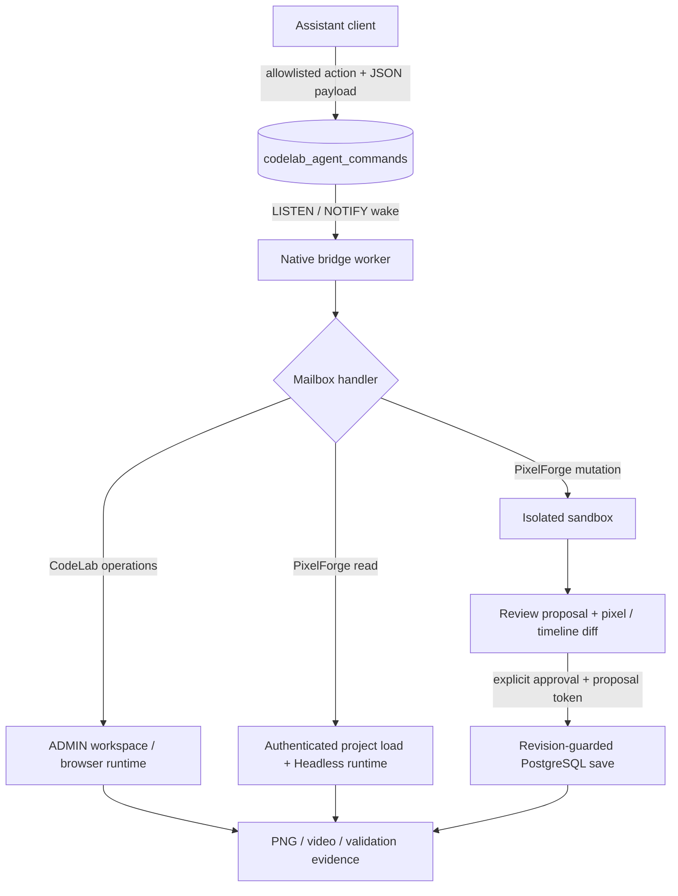

# CodeLab + PixelForge native command catalog

This document is the source-of-truth inventory for the native assistant mailbox. It distinguishes **mailbox actions** (submitted to `codelab_agent_commands`) from **Headless operations** (the structured operations inside a PixelForge batch). Adding a name to a SQL CHECK constraint does not implement a command: every mailbox action must also have a worker handler, client allowlist entry, authorization rules, result contract, and tests.

## Execution and safety model

- Commands are scoped to the ADMIN workspace; the worker resolves the workspace rather than trusting a caller-supplied workspace ID.
- PixelForge reads are read-only. Mutations run in an isolated Headless sandbox and do not persist merely because a batch succeeded.
- PixelForge persistence requires an explicit proposal approval and a valid proposal token. The server-issued `serverRevision` is the concurrency guard; conflicts must not overwrite another session.
- Command payloads are JSON objects. The assistant client caps a serialized payload at 2 MiB and TTL at 1 second–15 minutes. ZIP bytes do not travel inside a mailbox JSON payload: the client stages them in workspace-scoped, SHA-256-verified 1 MiB PostgreSQL chunks, then submits only an artifact ID. ZIP artifacts are capped at 256 MiB and expire after one hour unless consumed earlier.
- A terminal result is `succeeded`, `failed`, `rejected`, or `expired`; proposal-producing work may pause at `awaiting_approval`.
- Never put provider API keys, passwords, or other secrets in command payloads or project documents.

## Mailbox actions

These are the executable top-level action names routed by `agent-bridge-worker.mjs`. Fields below describe the current handler contract; optional fields are omitted unless the caller needs them.

### CodeLab platform

| Action | Purpose | Payload contract / result |
|---|---|---|
| `status` | Bridge health and protocol status. | Optional `operation: "mint_admin_handoff"`; otherwise returns online state, protocol, workspace, runtime, approval and persistence metadata. |
| `codelab_project_import` | Import a `.codelab` artifact. | `import_request_id`, `artifact_base64` or `artifact: { dataBase64, filename, contentType }`; optional `artifact_filename`, `artifact_content_type`. Returns import/confirmation status. |
| `codelab_project_create` | Create a CodeLab project in ADMIN. | Project creation fields consumed by `createCodeLabProject`; returns created project identity and persistence state. |
| `codelab_project_convert_to_web` | Convert a supported project to a web project. | `project_id`; returns conversion result. |
| `codelab_project_inspect` | Inspect project metadata/state. | `project_id`; returns compact project inspection. |
| `codelab_project_connect` | Connect/link a CodeLab project. | Connection fields consumed by `connectCodeLabProject`; returns connection result. |
| `codelab_project_get_code` | Read project source. | `project_id`; returns HTML/CSS/JS source and revision metadata. |
| `codelab_project_update_code` | Update project source. | `project_id`, `code` (HTML/CSS/JS only), optional `base_revision`; returns persistence verification and new revision. |
| `codelab_project_capture_png` | Capture a project's rendered UI. | `project_id` plus supported capture options; returns PNG evidence. |
| `codelab_project_record_video` | Record a CodeLab UI session. | `project_id` plus supported recording options; returns video evidence metadata. |
| `codelab_ui_execute` | Execute explicit browser UI actions in the isolated CodeLab browser runner. | `execution_mode: "browser"`, `actions`, optional `start_path`, `width`, `height`; actions include `open_screen`, `open_panel`, `click`, `scroll`, `type`, `select`, `wait_for`, `screenshot`, `record_video`. External navigation is rejected. |
| `codelab_validate` | Run the native validation engine. | `operation: "list"` returns validator catalog; otherwise `target`, `input` (or payload), optional `options`. Returns pass/fail, score, issues and details. |
| `neon_function_invoke` | Invoke an authorized Neon function. | Function invocation fields are validated by `invokeNeonFunction`; returns function result or structured failure. |

### PixelForge project and evidence actions

| Action | Purpose | Payload contract / result |
|---|---|---|
| `pixelforge_create` | Create a PixelForge project. | Project dimensions/name options consumed by `createProject`; returns project identity and initial revision. |
| `pixelforge_list` | List projects in the resolved PixelForge workspace. | No required fields; returns project summaries. |
| `pixelforge_inspect` | Inspect a project, including drawing intelligence. | `project_id`; optional `operation`: `model`, `sheet`, `object`, `layer`, `references`, or `reference`, `vector_model`, `vector_audit`, or `vector_svg`. Object/layer/reference selectors use `layer_id`, `x`, `y`, `grid_step`, `include_coordinates`, `reference_id`. Vector operations return the editable vector model, audit report or SVG string without requiring a mutation proposal. |
| `pixelforge_intelligence` | Read drawing model/sheet/object/layer/reference intelligence. | `project_id`, optional `operation` (defaults to `model`), plus the selectors above; vector operations `vector_model`, `vector_audit`, `vector_svg` are also read-only. Returns inspection and the requested intelligence result. |
| `pixelforge_animation_frame_context` | Read frame and optional layer context. | `project_id`, `index`, optional `layer_id`; returns frame context and server revision. |
| `pixelforge_capture_interface` | Open the real PixelForge web editor in Chromium and capture the interface and canvas. | Optional viewport `width` (640–2560), `height` (480–1800), `full_page`, and `zoom` (1–3); returns image evidence and browser/page diagnostics. |
| `pixelforge_export_image` | Export the selected project/frame as SVG. | `project_id`, optional `frame_index`; returns SVG as Base64 with dimensions and revision. Legacy `operation: "capture_interface"` is retained for backward compatibility. |
| `pixelforge_export_animation_video` | Render/record an animation using the real browser Video Composer path. | `project_id`, optional `include_vector_overlay` (default `true`) and supported persistence/upload settings; returns validated video artifact metadata. Vector overlays are rasterized into the PNG timeline package before export. This is a long-running command. |
| `pixelforge_preview_evidence_video` | Preview existing PixelForge evidence video. | Evidence lookup fields consumed by `previewPixelForgeEvidenceVideo`; returns preview metadata. |
| `pixelforge_import_zip` | Import an editable PixelForge ZIP package as a new project. | `artifact_id` from `client.importPixelForgeZip(bytes, options)`; optional `group_name`. Returns new project ID, revision 1, package metadata and inspection. Original project IDs are never overwritten. |
| `pixelforge_export_zip` | Export an editable project plus transparent PNG timeline frames (raster composites with the vector overlay rasterized by Chromium) and manifest. | `project_id`; returns a workspace-scoped artifact receipt with SHA-256, byte size and filename. `client.exportPixelForgeZip()` also retrieves the verified ZIP bytes. |
| `pixelforge_video_composer` | Remotely control the real Video Composer page in Chromium. | `project_id`, `operations` (1–20). Supported operation types: `inspect`, `seek` (`index` 0–239), `play` (`duration_ms` 100–10,000), `configure` (`format`, `output_fps`, `resolution`, `aspect`, `loop_export`, `solid_background`), `capture_preview`, `capture_studio`, `record_studio` (`duration_ms` 1,000–30,000). Returns imported timeline state, operation results, browser diagnostics and staged evidence artifacts. |
| `pixelforge_propose` | Run a structured Headless batch and create a review proposal. | `project_id`, `actions` (1–500 Headless operations), and a short `summary`; returns proposal token, inspection and pixel/timeline diff. |
| `pixelforge_approve` | Approve and persist a pending proposal. | `proposal_command_id`, `proposal_token`; server revalidates the proposal and revision before saving. |
| `pixelforge_discard` | Discard a pending proposal. | `proposal_command_id`, `proposal_token`; marks the pending proposal rejected. |

## PixelForge Headless operation catalog

The operations below are **not separate SQL mailbox actions**. They are the `name` values accepted inside `pixelforge_propose.actions[]`, or used by read-only inspection handlers. The authoritative runtime constants are `HEADLESS_CAPABILITIES` in `public/pixelforge/src/headless.js`.

### Raster, canvas, layers, selection, history and drawing intelligence

- Document/state: `document.get_summary`, `document.rename`, `drawing.model.get`, `drawing.sheet.get`, `drawing.sheet.configure`, `drawing.palette.get`, `drawing.current_state.set`, `drawing.current_state.get`.
- Coordinates and inspection: `canvas.get_reference`, `canvas.get_pixel`, `drawing.object.select_at`, `drawing.object.inspect`, `drawing.layer.inspect`, `layer.get_context`.
- Drawing references and environment history: `drawing.reference.extract_line_guide`, `drawing.reference.create`, `drawing.reference.package_current`, `drawing.reference.list`, `drawing.reference.get`, `drawing.reference.apply`, `drawing.reference.copy_part`, `drawing.reference.copy_frame`, `drawing.reference.remove`, `drawing.environment_history.record`, `drawing.environment_history.get`, `drawing.environment_history.list`, `drawing.layer.role.set`, `drawing.layer.context.set`, `drawing.motion.analyze`.
- Raster edits: `canvas.draw_line`, `canvas.draw_stroke`, `canvas.fill`, `canvas.clear_region`, `canvas.copy_region`, `canvas.paste_region`, `canvas.crop`, `canvas.draw_shape`, `canvas.fill_gradient`, `canvas.flip_region`, `canvas.create_outline`, `canvas.replace_color`, `canvas.preview_transform_region`, `canvas.transform_region`.
- Layers: `layer.add`, `layer.select`, `layer.move`, `layer.rename`, `layer.set_opacity`, `layer.set_visibility`, `layer.set_locked`, `layer.duplicate`, `layer.delete`.
- Selection: `selection.clear`, `selection.create_rect`, `selection.create_ellipse`, `selection.create_lasso`, `selection.create_magic`, `selection.modify`, `selection.combine`, `selection.translate`.
- History: `history.undo`, `history.redo`.

#### Reference copy contract

The only supported copy destinations for Reference Center content are the **currently active layer in the currently active frame**:

- `drawing.reference.copy_part` copies the selected part's pixels into that active layer, replacing its previous pixels.
- `drawing.reference.copy_frame` composites the reference frame's visible layers using their visibility, opacity and alpha, then replaces the active layer's pixels with that composite.
- There is no destination selector and no separate per-source-layer copy mode. The removed `drawing.reference.copy_frame_layer` action must not be reintroduced as an alternative.
- Copying never creates, deletes, duplicates or reorders project layers. Existing layer IDs and layer properties remain unchanged.
- The active frame/timeline is not closed, reset or replaced. The active animation cel is updated with the copied pixels.
- The source reference remains immutable. Copying duplicates pixel data; it does not create a live link to the Reference Center entry.
- Browser and Headless behavior must match. Integration tests should verify the unchanged layer count/IDs, active-cel persistence after save/reload, and continued availability of the original reference.

Do not confuse this behavior with creating a new layer explicitly through `layer.add` or `layer.duplicate`; those are separate user-requested layer operations.

### Vector studio and geometry model

The vector document is stored in `RasterDocument.vectorModel`, so it participates in the same sandbox revision, proposal diff, approval and PostgreSQL project JSON as raster layers. These actions are Headless batch operations (not SQL mailbox actions):

- Read/validation: `vector.model.get`, `vector.audit`, `vector.svg.export`.
- Model settings: `vector.model.configure` (`grid`, `snap`, `metadata`), `vector.precision.configure` (`precision` object), `vector.frames.set` (`frames`, up to 240 entries).
- SVG: `vector.svg.import` (`svg`, optional `replace`, maximum 2 MiB), `vector.svg.export`.
- Objects: `vector.object.create` (`object` of type `rect`, `ellipse`, `line`, `path`, `text` or `group`, optional insertion `index`); `vector.object.update` (`object_id`, `patch`, ID/type immutable); `vector.object.delete` (`object_id`); `vector.object.duplicate` (`object_id`, recursively regenerates IDs); `vector.object.reorder` (`object_id`, top-level `index`); `vector.object.transform` (`object_id`, transform values).
- Grouping: `vector.group.create` (`object_ids` containing at least two top-level IDs, optional `group_name`), `vector.group.ungroup` (`object_id`).
- Validation enforces unique IDs including nested group children, supported object types, finite geometry, valid SVG parsing (including a safe Node XML fallback), rejects DTD/entities/scripts/foreignObject and external resource URLs, and enforces the 16 MiB Headless vector-model budget. Audit warnings (for example out-of-bounds geometry) are returned; fatal audit errors block the mutation. The worker normalizes generated object/group/duplicate/SVG IDs before the proposal is previewed and stores those exact actions for approval replay, so the accepted model matches the reviewed diff.

### Animation and timeline

- Timeline: `animation.get_summary`, `animation.undo`, `animation.redo`, `animation.set_fps`, `animation.set_loop`, `animation.set_playback_speed`.
- Frames: `animation.frame.add_from_layer`, `animation.frame.capture_composite`, `animation.frame.capture_document`, `animation.frame.duplicate`, `animation.frame.delete`, `animation.frame.reorder`, `animation.frame.set_duration`, `animation.frame.set_active`.
- Cels and preview: `animation.frame.get_cel`, `animation.frame.set_cel`, `animation.frame.get_context`, `animation.frame.get_onion_skin`, `animation.frame.get_composite`.

### ZIP import/export and artifact transfer

- Editable exports contain `project/<name>.pforge` (canonical JSON with raster layers, vector model and animation cels), `manifest.json`, `README.txt`, and transparent `frames/frame-0001.png`… files in playback order. The same archive is valid as a Video Composer package.
- Import requires the editable `.pforge` project entry and a `pixelforge-video-package` version-1 manifest whose dimensions and frame count match the project. The importer validates ZIP paths, duplicate names, local/central directory agreement, CRC-32, project schema, raster byte lengths, vector model, and animation timeline.
- ZIP reader currently accepts uncompressed STORE entries only; encrypted, multi-disk, data-descriptor, ZIP64 and compressed-DEFLATE ZIPs are rejected with an explicit error. Maximum 512 entries / 256 MiB uncompressed total; project JSON remains limited to 96 MiB.
- Import creates a new project identity and resets `revision`, `saveVersion` and `serverRevision` before inserting revision 1. It never replaces an existing project.
- Large ZIP transfers use `codelab_agent_artifacts` and `codelab_agent_artifact_chunks`, scoped to the ADMIN mailbox workspace. Chunks are 1 MiB and individually plus globally SHA-256 checked. Supported artifact kinds are `pixelforge_zip_upload`, `pixelforge_zip_export`, `pixelforge_composer_png`, and `pixelforge_composer_video`.

### Video Composer remote control and evidence

- `pixelforge_video_composer` opens the deployed Video Composer route in a fresh Playwright Chromium session, imports the project's own generated ZIP package, and performs the requested operation batch against the real page DOM and canvas.
- `inspect` reads the loaded frame count/FPS/dimensions/duration/current frame/status; `seek` updates the timeline scrubber; `play` plays for a bounded duration and pauses; `configure` changes supported output controls; `capture_preview` returns the rendered preview canvas PNG; `capture_studio` stores a full-page Composer screenshot; `record_studio` records the Composer page as WebM through Playwright video capture.
- `pixelforge_export_animation_video` remains the dedicated deterministic WebM export command. It imports the project timeline into Video Composer and validates the downloaded WebM before persisting evidence.
- `record_studio` records the Composer page itself, not the user's entire desktop or another browser tab. The UI's `getDisplayMedia` screen-sharing controls still require a real user gesture/permission and are not bypassed by the agent.
- Each remote control call is an isolated short-lived Chromium session; put sequential controls in one `operations` array when they must share the same imported timeline state.

### Runtime limits and persistence guarantees

- Batch maximum: 500 actions. Maximum 64 raster layers and 240 animation frames, subject to memory and serialized project limits.
- Canvas dimension maximum: 4096 × 4096. Region reads are bounded to 32 × 32 / 1024 pixels.
- Raster and animation raw RGBA budgets are each 64 MiB; the combined serialized project envelope is 96 MiB.
- PixelForge raster, vector and animation mutations require review/approval. The source project is not modified by an unapproved sandbox batch. The vector model is included in the proposal's revision guard and saved project JSON.
- The runtime is deterministic and DOM-free; it does not run a real-time animation playback clock. Real interface/video evidence is captured separately through Chromium.

## Explicit coverage boundaries (do not misrepresent)

- The native mailbox covers the CodeLab platform and the PixelForge Headless raster/animation, drawing-intelligence, project and evidence contracts listed above.
- The vector model is now integrated into the Headless sandbox and proposal persistence. The operation catalog above covers object creation/update/deletion/duplication/reordering/transforms, groups, SVG import/export, precision metadata and vector frame metadata. UI-only affordances that do not map to the versioned vector model remain outside the mailbox.
- Editable ZIP import/export is remotely executable through chunked artifacts. The ZIP reader intentionally supports STORE-only archives at this stage; compressed/DEFLATE archives must be re-exported using PixelForge's STORE package exporter.
- Video Composer import, timeline playback/seek/configuration, preview capture, full-page screenshot, WebM page recording and deterministic animation export are remotely executable. Browser display capture of the user's external desktop/tab still requires user gesture and permission and is not remotely simulated.
- Provider-backed AI generation is separate from the deterministic Headless runtime. It must reuse CodeLab's existing user-owned provider settings and must not leak API keys or send artwork without the configured consent flow.

## Change checklist

Whenever the catalog changes, update all of these in the same PR:
1. `agent-bridge-worker.mjs`: executable handler and SQL CHECK migration.
2. `assistant-headless-client.mjs`: `NATIVE_ACTIONS` allowlist and ergonomic wrapper when appropriate.
3. `migrations/*.sql`: durable database constraint for fresh/existing deployments.
4. Contract tests: worker cases, client allowlist, SQL allowlist, payload validation, approval/auth behavior and result contract.
5. This catalog and the relevant architecture/README documentation.
6. CI: run native worker, CodeLab validation, PixelForge Headless, animation, vector, ZIP/video and browser evidence suites. A passing unit suite does not prove live Render/Neon connectivity.
