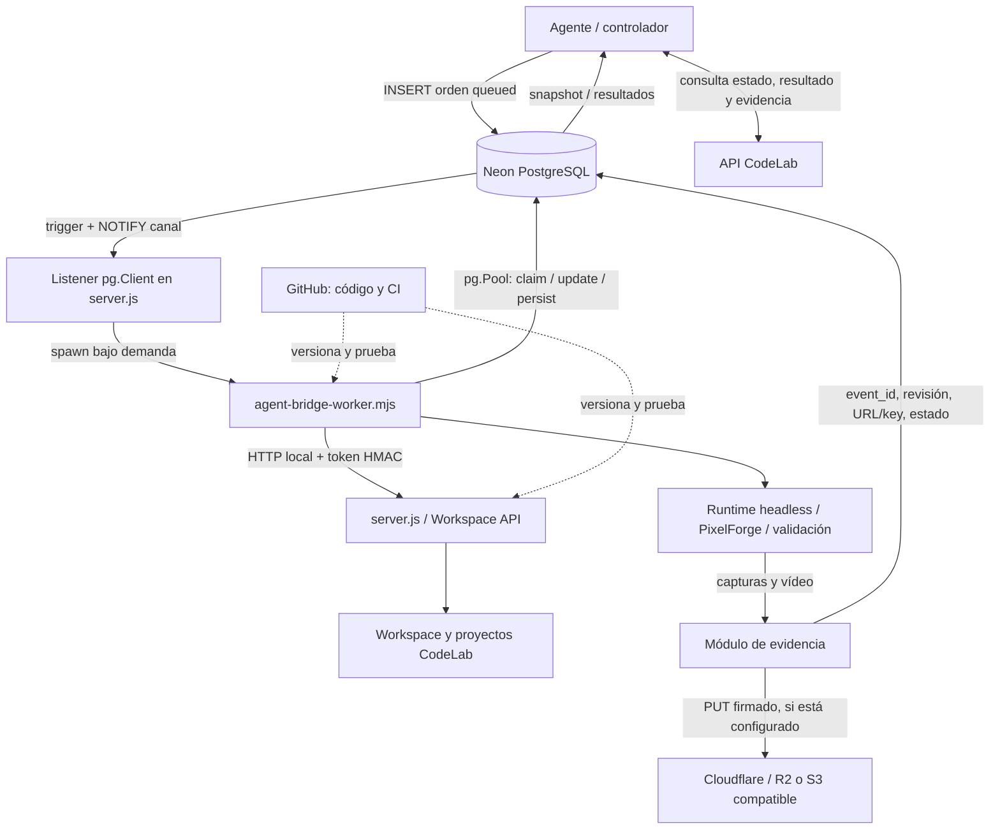
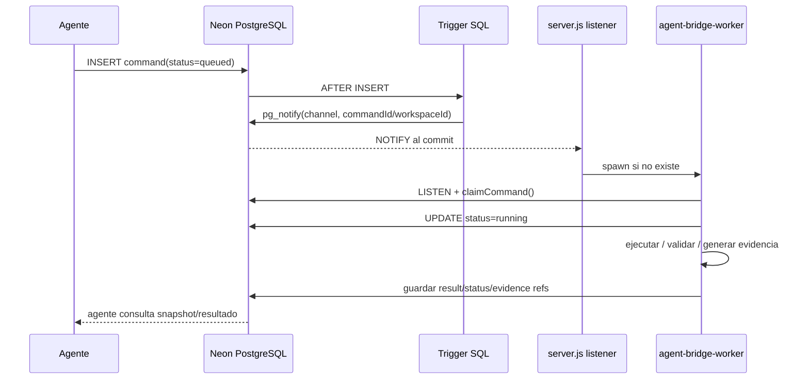
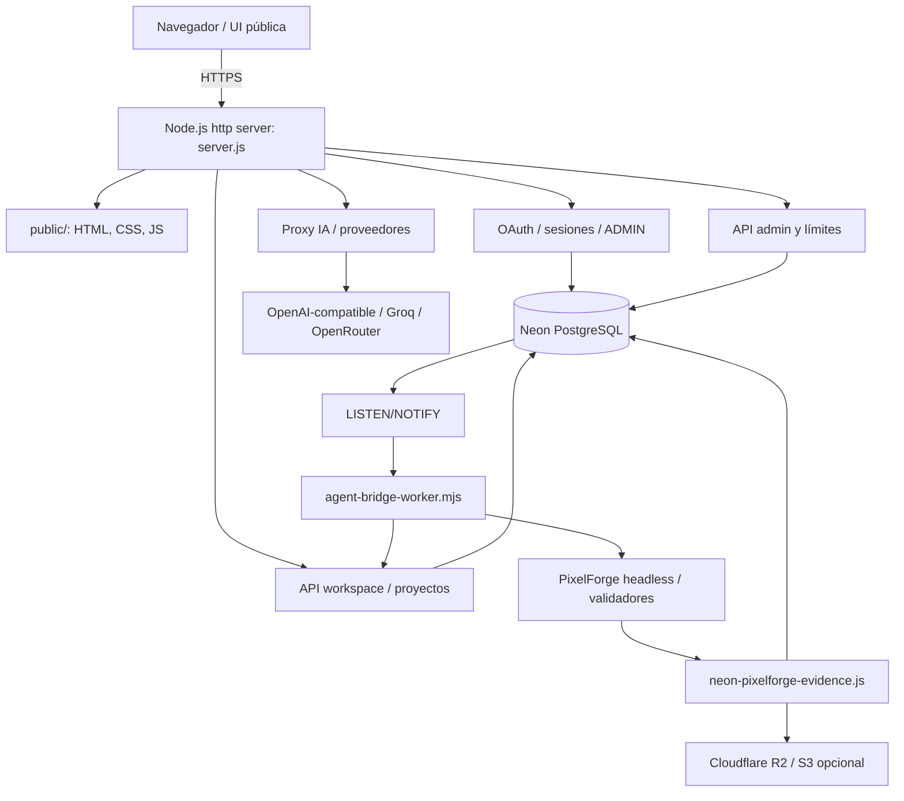

# CodeLab ↔ Neon: arquitectura y comunicación técnica extremo a extremo

> **Documento de referencia del comportamiento implementado.** Se mantiene sincronizado con `server.js`, `agent-bridge-worker.mjs`, los módulos de persistencia/evidencia y las pruebas. Describe el código de esta rama; no implica que la rama esté desplegada en producción.
>
> Última revisión: 2026-11-23. Rama de trabajo: `fix/pixelforge-integrity-wave-1`.

## 1. Resumen ejecutivo

CodeLab es una aplicación Node.js que usa PostgreSQL de Neon para identidad/cuentas, órdenes del agente, proyectos persistentes, revisiones y metadatos de evidencia. El servidor web y el worker nativo son procesos distintos:

- **`server.js`** atiende HTTP, gestiona autenticación/workspaces y mantiene un listener PostgreSQL que recibe notificaciones de nuevas órdenes.
- **`agent-bridge-worker.mjs`** reclama órdenes persistidas, ejecuta acciones de forma programática, valida resultados y escribe estados/resultados/evidencias.
- **Neon PostgreSQL** es la fuente de verdad durable. Una notificación solo despierta procesos; no contiene ni reemplaza la orden.
- **Cloudflare/R2 u otro almacenamiento compatible**, cuando está configurado, transporta/almacena bytes grandes de evidencia. Neon conserva los metadatos y la relación con proyecto/revisión/evento.
- **GitHub** versiona el código y ejecuta CI. No es el buzón de cada edición de proyecto ni el transporte normal de vídeos.

El worker ya no consulta la cola cada 150 ms. Usa `LISTEN/NOTIFY` y espera bloqueado hasta recibir una señal. La consulta SQL se ejecuta al iniciar y después de cada despertar; no existe un intervalo de sondeo en reposo.

## 2. Diagrama de componentes



### Límites importantes

1. El listener del servidor no ejecuta el trabajo: solo recibe la notificación y arranca el worker.
2. PostgreSQL NOTIFY es una señal efímera y de tamaño limitado. La fila en `codelab_agent_commands` es la orden durable.
3. El worker no es una VM persistente ni un servicio independiente de hosting: es un proceso Node hijo del servidor CodeLab.
4. El agente conserva la responsabilidad de decidir qué tarea nueva iniciar. El worker solo completa órdenes ya autorizadas y persistidas.
5. Las capturas/vídeos son evidencia de inspección. El documento de proyecto y su revisión en Neon son la fuente canónica del estado editable.

## 3. Conexión PostgreSQL: configuración y topología

### 3.1 Variable de conexión

La conexión se configura mediante `DATABASE_URL` en el entorno del servidor. Contiene el endpoint PostgreSQL, puerto, base, usuario y credencial. Nunca se debe imprimir la URL completa en logs ni incluirla en documentación.

El modo TLS se controla con:

| Variable | Comportamiento |
|---|---|
| `CODELAB_DATABASE_SSL` ausente o distinto de `disable` | `ssl: { rejectUnauthorized: false }` |
| `CODELAB_DATABASE_SSL=disable` | TLS desactivado; reservado para entornos locales de prueba que lo necesiten |

**Nota de seguridad:** `rejectUnauthorized: false` cifra la conexión TLS, pero no valida la cadena/certificado del servidor. No equivale a verificación estricta de identidad del servidor. Antes de cambiarlo en producción hay que confirmar la compatibilidad de certificados/CA del proveedor y probarlo en CI/hosting.

### 3.2 Pool del servidor

En `server.js`:

- Driver: paquete `pg` (Node PostgreSQL).
- Objeto: `accountPool`.
- Máximo: 5 conexiones.
- `idleTimeoutMillis`: 30 000 ms.
- `connectionTimeoutMillis`: 10 000 ms.
- Usa `DATABASE_URL` y la constante `DATABASE_SSL`.

El pool sirve las operaciones SQL del servidor: cuentas, autenticación/workspaces, snapshots del bridge y endpoints que consultan o actualizan datos persistentes.

### 3.3 Pool del worker

En `agent-bridge-worker.mjs`:

- Driver: `pg.Pool`.
- Usa la misma `DATABASE_URL` y el mismo criterio `CODELAB_DATABASE_SSL`.
- Máximo: 2 conexiones.
- `idleTimeoutMillis`: 15 000 ms.
- `connectionTimeoutMillis`: 10 000 ms.

El pool del worker se usa para reclamar órdenes, mantener heartbeats durante una ejecución, leer/guardar proyectos y escribir resultados/estado.

### 3.4 Conexiones dedicadas para LISTEN

PostgreSQL `LISTEN` debe permanecer asociado a una conexión backend estable. Por eso no se usa una conexión prestada y devuelta al pool para mantener la suscripción.

Hay dos clientes dedicados:

- En el servidor: `pg.Client`, aplicación `codelab-agent-bridge-wake-listener`.
- En el worker: `pg.Client`, aplicación `codelab-agent-bridge-command-listener`.

Ambos escuchan el canal `codelab_agent_bridge_wake`. El primero arranca el proceso worker si no existe; el segundo despierta el bucle del worker que ya está activo.

### 3.5 Endpoint pooled frente a endpoint directo

La variable `DATABASE_URL` puede apuntar a un hostname Neon con `-pooler`. Los pools SQL normales pueden usar ese endpoint pooled. Para los clientes dedicados de LISTEN, el código ejecuta `databaseUrlForWakeListener()` / `directDatabaseUrl()`: si el hostname contiene `-pooler.`, reemplaza ese fragmento por `.` y conserva el resto de la URL.

Ejemplo conceptual (no usar credenciales reales):

- pooled: `ep-example-pooler.region.aws.neon.tech`
- directo: `ep-example.region.aws.neon.tech`

La conversión se hace solo para los clientes LISTEN; no modifica `DATABASE_URL` ni los pools normales. Debe mantenerse coordinada entre servidor y worker.

## 4. Esquema del buzón de órdenes

La tabla central es `public.codelab_agent_commands`.

| Columna | Tipo / propósito |
|---|---|
| `command_id` | `text`, clave primaria e identificador único de orden |
| `workspace_id` | workspace propietario/objetivo |
| `action` | operación autorizada a ejecutar |
| `payload` | `jsonb`, argumentos de la operación |
| `status` | estado del ciclo de vida |
| `result` | `jsonb`, salida, error, referencias y validación |
| `proposal` | propuesta aislada cuando requiere aprobación |
| `proposal_token` | token de aprobación temporal |
| `created_at`, `updated_at` | trazabilidad temporal |
| `started_at`, `finished_at` | inicio y fin |
| `expires_at` | vencimiento de la orden |

Estados reconocidos por el worker: `queued`, `running`, `awaiting_approval`, `succeeded`, `rejected`, `failed`, `expired`.

Índices relevantes:

- `(status, created_at)` parcial para filas `queued`.
- `(workspace_id, created_at DESC)` para historial por workspace.

La lista exacta de acciones permitidas está protegida por una constraint CHECK que se crea/actualiza desde el código. Al agregar una acción hay que actualizar la migración/constraint, el dispatcher del worker, validaciones, documentación y pruebas.

## 5. Cómo una orden despierta al sistema

### 5.1 Trigger transaccional

Durante `ensureAgentBridgeWakeListener()`, `server.js` crea/asegura:

- `codelab_agent_commands`
- `codelab_agent_bridge_state`
- función PostgreSQL `codelab_agent_bridge_wake()`
- trigger `codelab_agent_bridge_wake_trigger`

El trigger es `AFTER INSERT OR UPDATE OF status` sobre `codelab_agent_commands`. Si `NEW.status = 'queued'`, ejecuta:

```sql
SELECT pg_notify(
  'codelab_agent_bridge_wake',
  json_build_object(
    'commandId', NEW.command_id,
    'workspaceId', NEW.workspace_id
  )::text
);
```

PostgreSQL entrega la notificación después de confirmar la transacción. El payload de NOTIFY es una pista compacta; el contenido completo sigue en la fila JSONB.

### 5.2 Listener del servidor

Al iniciar el servidor, este arma el listener dedicado con:

```sql
LISTEN codelab_agent_bridge_wake;
```

Cuando recibe una notificación válida, llama `startAgentBridge()`. Esa función hace `spawn(process.execPath, [workerPath])` y evita crear un segundo hijo si `agentBridgeWorker` ya existe.

El servidor no inicia el worker incondicionalmente al arrancar. Mantiene armado el listener y levanta el worker cuando una orden queued lo requiere. También existe la ruta autenticada `POST /api/agent/bridge/ensure` (GET está soportado como fallback) para un arranque explícito controlado; no es un cron ni un mecanismo de polling.

### 5.3 Reconciliación al armar/reconectar

NOTIFY no es una cola durable y una notificación emitida antes de que LISTEN quede activo puede perderse. Por eso, después de activar LISTEN, el servidor consulta la tabla por cualquier orden no expirada con `status='queued'` y arranca el worker si encuentra una.

La reconciliación **no debe filtrar por `payload.wake`**: todas las filas queued representan trabajo pendiente, tanto si llevan ese indicador como si no. El código actual aplica esta regla.

### 5.4 Diagrama de secuencia



## 6. Ciclo interno del worker (sin polling de reposo)

Al iniciar, el worker:

1. valida que exista `DATABASE_URL`;
2. crea su pool;
3. asegura el esquema del buzón y sus índices/constraints;
4. resuelve la cuenta ADMIN y su workspace `ws_local_<id>`;
5. asegura `codelab_agent_bridge_state`;
6. registra estado `running`;
7. abre su propio `LISTEN codelab_agent_bridge_wake`;
8. configura el workspace PixelForge según `PIXELFORGE_GUEST_MODE`;
9. entra en el bucle de consumo.

En cada iteración:

1. guarda un contador local `wakeVersion`;
2. llama `claimCommand()` una vez;
3. si no hay orden, espera una notificación (Promise resuelta por el evento PostgreSQL);
4. si llegó una notificación entre el claim y el inicio de espera, el contador detecta el cambio y evita perder el wake;
5. si hay orden, la procesa y vuelve al claim.

No hay `POLL_MS`, `setInterval` de sondeo de cola ni SELECT repetido cada 150 ms. Un worker ocioso permanece esperando en LISTEN. Los únicos temporizadores relacionados con actividad son:
- heartbeat de una orden que está ejecutándose: cada 30 segundos;
- reconexión del listener del worker si se pierde: espera de 5 segundos antes de reintentar;
- espera corta de recuperación tras errores del bucle de mailbox: 2,5 segundos.

Esos temporizadores no son sondeo normal de órdenes ni keep-alive del worker.

### 6.1 Reclamo atómico

`claimCommand()` obtiene una conexión del pool y abre una transacción:

1. marca `expired` las órdenes queued cuyo `expires_at <= now()`;
2. recupera órdenes `running` abandonadas que todavía no expiraron (umbral general de 3 minutos; para exportación de vídeo, 10 minutos; `codelab_validate` se excluye de esa recuperación);
3. selecciona una fila queued no expirada del workspace ADMIN, ordenada por `created_at`, con `FOR UPDATE SKIP LOCKED LIMIT 1`;
4. si no hay fila, confirma y devuelve `null`;
5. si la hay, actualiza `status='running'`, `started_at` y `updated_at`, confirma y devuelve la orden.

`FOR UPDATE SKIP LOCKED` evita que consumidores concurrentes reclamen la misma fila.

### 6.2 Heartbeat y recuperación

Mientras se ejecuta una orden, se actualiza `updated_at` cada 30 segundos. Si el proceso desaparece y el heartbeat deja de avanzar, la lógica de recuperación puede volver a encolar la orden según los umbrales anteriores, siempre que no haya expirado. La expiración inicial por defecto es de 15 minutos; las rutas de creación pueden establecer su propia expiración dentro de las reglas de la aplicación.

### 6.3 Ejecución y validación

El dispatcher del worker enruta `action` a operaciones específicas: estado, proyectos PixelForge, propuestas/aprobaciones, importación/inspección de proyectos CodeLab, edición de código, captura PNG/vídeo, UI programática y operaciones de validación. Tras procesar, puede ejecutar `validateAfterCommand()`; una validación fatal puede marcar el resultado como fallido aunque la acción inicial haya devuelto salida.

Para operaciones que requieren aprobación, la propuesta se prepara en memoria, calcula un diff y se guarda como `awaiting_approval`; el proyecto persistido no se modifica hasta que se aprueba con token vigente y revisión base coincidente.

### 6.4 Errores y reconexión

- Error de conexión del listener del worker: se limpia la referencia del cliente, se despierta el bucle y se intenta reconectar tras 5 segundos.
- Tras reconectar, el worker vuelve a reclamar desde la tabla durable para recuperar señales perdidas.
- Error transitorio de mailbox: se registra y se reintenta después de 2,5 segundos.
- Error fatal de arranque: se intenta escribir una señal de apagado/error y el proceso termina con código no cero.
- El listener del servidor programa reintento tanto si falla la conexión inicial al arrancar como si una conexión ya establecida emite error; usa backoff exponencial limitado (1, 2, 4, 8, 16, 32 y hasta 60 segundos). Si Neon vuelve a estar disponible, el listener se rearma y reconcilia la cola durable.

## Comportamiento cuando el servidor/worker está dormido

El estado `sleeping` del bridge debe interpretarse como **proceso terminado**, no como un worker simplemente ocioso. Cuando CodeLab queda sin el proceso consumidor, una orden puede permanecer durablemente en Neon con `status='queued'` hasta que el listener/worker vuelva a estar disponible. La orden no se pierde porque Neon conserva la fila como fuente de verdad.

La recuperación funciona así:

1. Una orden nueva se inserta en Neon con `status='queued'`.
2. Si el servidor está activo y su listener PostgreSQL está conectado, el trigger emite `NOTIFY` y CodeLab levanta el worker.
3. Si la notificación ocurrió mientras el listener no estaba activo, al iniciar o reconectar `LISTEN` el servidor **reconcilia la cola durable** y busca órdenes queued no expiradas, por lo que no depende de recuperar una notificación perdida.
4. El worker reclama la orden desde Neon con su transacción normal y continúa la ejecución.
5. Si el proceso worker termina y deja `sleeping` + `wake_required=true`, el estado sirve como señal de que debe reactivarse; `sleeping` no significa que exista un worker vivo esperando.

Por tanto, **Render/hosting puede dormir o terminar el proceso sin convertir una orden queued en una pérdida de trabajo**. Lo importante para la recuperación es que la orden permanezca en Neon y que, cuando CodeLab vuelva a estar disponible, el listener reconcilie la cola y el worker la reclame. No se debe crear polling, cron ni keep-alive para evitar este estado.

Cuando el listener del servidor pierde conexión con Neon, aplica reintentos con backoff y, al reconectar, vuelve a reconciliar la cola. El listener del worker también reintenta y vuelve a reclamar desde el estado durable.

## 7. Señal de estado del bridge

Tabla: `public.codelab_agent_bridge_state`.

Campos:

- `state_id`: identificador lógico, actualmente `native-bridge:<workspaceId>`.
- `workspace_id`: workspace ADMIN.
- `state`: `starting`, `running`, `sleeping`, `stopping` o `error`.
- `wake_required`: indica que hace falta reactivar el worker para continuar.
- `wake_reason`: razón de la señal.
- `signal_version`: contador monotónico incrementado en cada escritura.
- `last_signal_at`, `updated_at`: tiempos de actualización.
- `metadata`: JSON con PID/host/source y, cuando corresponde, commandId, status, revisión y resumen.

Al iniciar, el worker escribe `running` y `wake_required=false`. Al completar una orden, escribe estado y resumen con `wake_required=false`. Al recibir SIGTERM/SIGINT o un error fatal, intenta escribir `sleeping`, `wake_required=true` y motivo antes de cerrar conexiones.

**No confundir estado lógico con proceso:** `sleeping` significa que el worker terminó y dejó una señal para reactivarlo; cuando el worker está ocioso esperando LISTEN sigue siendo un proceso vivo y su estado lógico permanece running.

El agente debe consultar el snapshot antes de reintentar. Nunca debe duplicar una orden que siga queued/running/awaiting_approval.

## 8. Endpoints de control del agente

### `POST /api/agent/bridge/ensure`

- Autenticación: header `x-codelab-agent-bridge-token` o parámetro `token` en fallback.
- Secreto esperado: `CODELAB_AGENT_BRIDGE_CONTROL_SECRET`.
- Inicia el worker si no existe; si ya está activo, devuelve su estado.
- GET también está aceptado como fallback de transporte.
- Respuestas no cacheables.
- No reemplaza el disparo automático por NOTIFY al insertar una orden.

### `GET /api/agent/bridge/state`

Devuelve un snapshot sin caché que incluye:
- estado y señal del bridge;
- estado local del proceso;
- últimas 20 órdenes y resultados;
- últimos 20 proyectos PixelForge con revisión y SHA;
- últimas 20 evidencias (si la tabla está disponible);
- información de wake/reconciliación.

El endpoint requiere el mismo token de control. Los resultados pueden contener payloads/resultados grandes; evitar consultarlo continuamente o transferir el snapshot completo si solo se necesita una columna/estado. Nunca exponer el token en URLs registradas en logs.

## 9. Workspace interno y ADMIN

El worker resuelve la fila `codelab_accounts` donde `username='ADMIN'` y `role='admin'`. Construye el workspace administrativo como `ws_local_<id normalizado>`. La persistencia de los proyectos que opera el bridge está asociada a ese workspace o al workspace PixelForge configurado para modo invitado.

Para acceder a la API interna del servidor, el worker llama endpoints locales de CodeLab y firma el acceso con el secreto `CODELAB_WORKSPACE_SECRET` mediante el mecanismo HMAC del workspace. Es una comunicación proceso-hijo → servidor local; no es una llamada pública a Internet. No escribir el secreto ni tokens firmados en logs.

Las sesiones headless temporales de pruebas no deben confundirse con el workspace ADMIN persistido. Para declarar que un cambio quedó guardado, hay que volver a leer el proyecto desde el servidor y comprobar revisión/hash.

## 10. Persistencia de proyectos PixelForge

Tabla principal: `codelab_pixelforge_projects`.

Campos usados por el worker incluyen:
- `workspace_id`, `project_id`, `name`, `width`, `height`;
- `project` JSONB con documento editable;
- `byte_size`;
- `server_revision`;
- `content_sha256`;
- `updated_at`, `last_opened_at`.

El worker valida dimensiones y límites de tamaño/proyectos, serializa el documento, calcula SHA-256 y guarda en transacción. Las escrituras críticas usan advisory lock por workspace y verifican la revisión esperada. Si la revisión base ya no coincide, devuelve conflicto en vez de sobrescribir cambios concurrentes.

La revisión y el hash son la referencia de integridad; una imagen/vídeo no sustituye el documento JSON persistido.

En importación/reimportación de paquetes, el worker verifica cada archivo esperado (ruta, tamaño, SHA-256 y bytes leídos de vuelta) antes de eliminar archivos obsoletos del mismo workspace/proyecto/editor. Después confirma el recuento exacto. La limpieza no se ejecuta antes de validar los archivos nuevos, por lo que una reimportación no acumula fotogramas/cels antiguos ni elimina la versión previa antes de verificar el reemplazo.

## 11. Evidencia visual y almacenamiento de objetos

El módulo `neon-pixelforge-evidence.js` registra eventos de cambio/evidencia en `codelab_pixelforge_change_events`. El evento asocia workspace, proyecto, revisión, tipo de cambio, estado, metadata y referencias de imagen/vídeo. El resultado de la orden puede incluir `evidenceEventId`.

Cuando las variables de almacenamiento están configuradas, el módulo puede subir el objeto binario a Cloudflare/R2 mediante URL firmada, o a un endpoint S3-compatible según la configuración. Neon guarda la referencia (object key/URL, estado, MIME y metadata). En modos de respaldo, puede persistir bytes en columnas de la tabla, por lo que no debe asumirse que todos los despliegues usan exclusivamente R2.

Separación de responsabilidades:
- Neon: órdenes, proyecto, revisión, hashes, evento, metadata y referencias.
- R2/S3: bytes grandes de vídeo/imagen cuando está configurado.
- CodeLab: genera la evidencia, enlaza el evento y verifica el resultado.
- Agente: inspecciona visualmente la evidencia y decide la siguiente tarea.

No afirmar que Cloudflare está activo solo porque el código soporte sus variables; comprobar configuración y resultado real del upload.

## 12. Consumo de datos: qué consultar y qué evitar

El polling de 150 ms fue eliminado porque hacía que el worker ejecutara repetidamente transacciones/consultas incluso sin órdenes. El diseño actual está basado en eventos.

Otras operaciones todavía pueden transferir muchos bytes:
- `GET /api/agent/bridge/state` incluye las últimas 20 órdenes con payload/result y las últimas evidencias; un resultado que incluya datos grandes aumenta transferencia.
- Los endpoints que devuelven un proyecto PixelForge pueden incluir el JSON completo, capas, frames y datos raster codificados.
- Las rutas de workspace/código pueden devolver contenido completo de proyectos.
- La carga/descarga de vídeo e imágenes tiene un volumen proporcional al tamaño del artefacto.

Buenas prácticas:
1. usar snapshot completo solo al inicio, al recuperar una tarea o al diagnosticar;
2. preferir consultas pequeñas/filtradas para seguimiento frecuente;
3. no duplicar Base64 de vídeos dentro de JSON si se puede transportar como objeto;
4. persistir en Neon metadatos y referencias para objetos grandes;
5. medir bytes por endpoint y SQL real antes de atribuir cuota a una ruta concreta;
6. no eliminar tablas/ramas para “arreglar” transferencia sin una auditoría que demuestre que el almacenamiento es el problema.

La retirada del polling elimina una fuente constante de consultas, pero no demuestra por sí sola que la cuota de Neon esté restaurada ni identifica el reparto histórico de transferencia.

## 13. Variables de entorno relacionadas

| Variable | Uso |
|---|---|
| `DATABASE_URL` | conexión PostgreSQL principal |
| `CODELAB_DATABASE_SSL` | TLS por defecto; `disable` solo para pruebas locales |
| `CODELAB_AGENT_BRIDGE_ENABLED` | si vale `0`, bloquea el arranque del worker |
| `CODELAB_AGENT_BRIDGE_CONTROL_SECRET` | protege endpoints ensure/state |
| `CODELAB_WORKSPACE_SECRET` | firma HMAC de API interna de workspace |
| `PIXELFORGE_GUEST_MODE` | determina si el worker opera el workspace PixelForge guest o el workspace ADMIN |
| `NEON_FUNCTIONS_ENABLED` | habilita operación de Neon Functions permitida |
| `NEON_FUNCTIONS_URL` | destino de función, validado contra allowlist del código |
| `NEON_FUNCTIONS_EXEC_SECRET` | autenticación de la invocación permitida |
| `CLOUDFLARE_EVIDENCE_BASE_URL` | base del endpoint de evidencia Cloudflare cuando se configura |
| `CLOUDFLARE_EVIDENCE_SIGNING_SECRET` | firma de operaciones de evidencia |
| `NEON_STORAGE_ENDPOINT` y credenciales S3 | almacenamiento S3-compatible alternativo, si está configurado |

Los valores secretos nunca se documentan. Para variables adicionales de la aplicación, consultar el bloque de configuración de README y el código que las consume.

## 14. Seguridad y límites

- Mantener secretos solo en el entorno del servicio; no versionarlos.
- Los endpoints de control requieren token constante y comparación segura.
- Las órdenes deben validar acción, workspace, estructura del payload y expiración.
- Los proyectos se escriben con revisión esperada, locks y límites de bytes/dimensiones.
- El worker usa endpoints locales autenticados para operaciones de workspace.
- Los uploads externos usan firmas temporales/HMAC cuando se configura el proveedor.
- No asumir que NOTIFY garantiza entrega durable; reconciliar siempre con la tabla.
- No permitir que una evidencia de una revisión se asocie a otra orden/proyecto.
- No habilitar una segunda cola, múltiples B ni stress workflows históricos como arquitectura normal.

## 15. Pruebas y verificación operativa

Cambios en el bridge deben cubrir, como mínimo:

1. el servidor arma `LISTEN codelab_agent_bridge_wake`;
2. INSERT/UPDATE a queued produce NOTIFY después del commit;
3. cualquier queued no expirada se detecta en la reconciliación de arranque;
4. el worker usa el endpoint directo y el mismo criterio SSL del servidor;
5. el worker reclama con transacción y `SKIP LOCKED`;
6. el worker espera LISTEN sin intervalo de polling;
7. una notificación que llega justo antes de dormir no se pierde (contador de versión);
8. la reconexión vuelve a reconciliar la cola durable;
9. finalización/errores actualizan orden y bridge state;
10. evidencia queda asociada a proyecto/revisión/evento.

Pruebas CI no equivalen a prueba en Render/Neon. Para una prueba real extremo a extremo, Neon debe aceptar conexiones y el entorno desplegado debe estar ejecutando la versión de esta rama. Si la cuota del proyecto Neon está excedida, no repetir el A/B de vídeo: primero restaurar la conexión/cuota o aprobar un transporte alternativo.

## 16. Reglas de mantenimiento de esta documentación

Cada cambio que afecte a conexión, pool, TLS, listener, trigger, cola, acciones, estados, reconexión, API de control, workspace, persistencia, evidencia, storage o límites de transferencia debe actualizar este documento **en el mismo cambio de código**.

Además:
- actualizar el resumen de arquitectura de `README.md`;
- actualizar `docs/CODELAB-NEON-ARCHITECTURE.md` si cambia persistencia/animación;
- actualizar pruebas/contratos junto con comportamiento;
- revisar el diagrama antes de presentar la implementación al usuario;
- indicar rama, commit y si se probó localmente, en CI o en producción;
- nunca describir un comportamiento antiguo como vigente por quedar mencionado en un documento histórico.


## 17. Arquitectura de la aplicación CodeLab completa

El sistema no es solo el bridge. La aplicación se divide en capas que cooperan:



### 17.1 Servidor HTTP y frontend

- El proceso de entrada es Node.js y usa el módulo nativo `http.createServer` en `server.js`; no es una aplicación Express.
- El servidor enruta solicitudes `/api/*`, aplica límites generales, autenticación/autorización por ruta y respuestas JSON con `Cache-Control: no-store`.
- Los archivos de interfaz se sirven desde `public/`. La UI se comunica con el backend por same-origin HTTP(S).
- Se definen encabezados de seguridad como `X-Content-Type-Options`, `X-Frame-Options`, `Referrer-Policy`, `Permissions-Policy` y HSTS en producción.
- `CODELAB_MAX_BODY_BYTES` limita el tamaño del cuerpo entrante (default documentado: 10 MiB). Las rutas pueden aplicar límites más estrictos por tipo de dato.
- El límite general por IP y el limitador dedicado de IA son independientes. La exención del límite general para ADMIN requiere una sesión local validada con rol admin; no acepta un header o parámetro enviado por el cliente como prueba de admin.

### 17.2 Autenticación, sesiones y workspaces

- Proveedores OAuth implementados: GitHub y Google.
- El inicio OAuth genera `state` y lo valida en el callback contra cookie HttpOnly de corta duración.
- Tras callback válido, CodeLab crea/asegura el workspace del usuario y crea una sesión persistida.
- La cookie de sesión se llama `codelab_sid`, es HttpOnly, SameSite=Lax y Secure cuando la solicitud es HTTPS; su duración se basa en `SESSION_TTL_MS`.
- Los workspaces OAuth son deterministas por proveedor/usuario, por ejemplo `ws_github_<id>` o `ws_google_<id>`, de modo que el usuario puede recuperar su espacio desde otro dispositivo.
- La API workspace autoriza mediante token HMAC `x-workspace-token` o por la sesión autenticada propietaria del workspace. La comparación de token se hace con `timingSafeEqual`.
- Los IDs OAuth reservados no pueden ser ocupados anónimamente. Las escrituras validan estructura de proyectos y `baseRevision`; un conflicto devuelve HTTP 409 y no sobrescribe el estado nuevo.
- La cuenta local ADMIN es distinta de la identidad OAuth de un usuario. El worker resuelve explícitamente `codelab_accounts.username='ADMIN'` y `role='admin'`.

### 17.3 Persistencia del workspace web

La tabla principal es `codelab_workspace_states`; guarda workspace_id, revision, state JSONB, owner y updated_at. Cuando no hay pool PostgreSQL configurado, el servidor puede usar archivos locales dentro de `CODELAB_DATA_DIR` como modo de desarrollo/fallback.

Con PostgreSQL activo:
- `readState()` intenta recuperar el estado de la tabla;
- si existe un archivo legacy y aún no hay fila, normaliza e importa el estado a la tabla;
- `writeState()` hace UPDATE condicionado a la revisión esperada;
- si la revisión no coincide, devuelve conflicto de escritura.

En hosting con disco persistente, `CODELAB_DATA_DIR` puede apuntar a `/var/data` para conservar archivos auxiliares/backups. El estado principal del workspace autenticado se guarda en PostgreSQL cuando `DATABASE_URL` está configurado.

### 17.4 Copiloto IA y credenciales por usuario

El endpoint principal es `POST /api/ai/complete`:
- valida prompt (máximo 8 000 caracteres);
- limita el tamaño combinado de HTML/CSS/JS a 200 000 caracteres;
- valida tamaño de API key suministrada por el cliente;
- aplica un limitador dedicado de IA;
- usa la key del usuario si se proporciona; si no, puede usar `AI_API_KEY` del servidor;
- cuando se usa una key del usuario, el endpoint/modelo del proveedor se toma de la configuración asociada a esa key y no se mezcla con el secreto del servidor;
- el proxy usa HTTPS, resuelve el destino y bloquea direcciones IP locales/privadas para reducir SSRF y DNS rebinding;
- errores upstream se convierten en respuestas controladas (por ejemplo 429 del límite local o 502 por proveedor).

Las preferencias/keys propias del usuario se administran en Ajustes del copiloto del navegador. No registrar keys en logs, ni trasladar credenciales entre cuentas OAuth. Las variables globales `AI_API_KEY`, `AI_BASE_URL`, `AI_MODEL`, `AI_MAX_TOKENS` y `AI_RATE_MAX` configuran el proveedor de servidor; no convierten la key privada de un usuario en una key global compartida.

### 17.5 PixelForge y runtime headless

- La UI PixelForge vive bajo `public/pixelforge/`.
- El runtime headless comparte modelos/validadores con la lógica del editor para inspeccionar, aplicar acciones y exportar sin depender de interacción manual en la UI.
- El worker crea/abre el runtime para ejecutar operaciones de dibujo, edición, exportación y vídeo.
- Las propuestas de cambios pueden ejecutarse en memoria, producir diff y esperar aprobación antes de escribir el proyecto.
- La persistencia de PixelForge usa documento JSONB, revisión incremental, hash SHA-256, límites de bytes/dimensiones y locks por workspace.
- Las pruebas de UI, headless, raster, vector, animación, vídeo y persistencia se ejecutan en workflows distintos; el resultado de un workflow debe asociarse a su SHA exacto.

### 17.6 Arranque y apagado del servicio

1. Node carga configuración y módulos.
2. Si hay `DATABASE_URL`, inicializa pool PostgreSQL.
3. Siembra/verifica la cuenta ADMIN cuando está configurada.
4. Asegura tabla de workspaces y sesiones; migra sesiones legacy y limpia expiradas.
5. Arma el listener Neon; reconcilia queued pendientes.
6. Asegura tabla PixelForge; si esta parte falla, la API de PixelForge puede responder 503 sin impedir que otras áreas web arranquen.
7. Abre el puerto `PORT`.
8. En apagado, el servidor detiene el worker y escribe la señal de cierre del bridge cuando puede acceder a Neon.

El servidor web puede estar operativo aunque el listener Neon falle temporalmente; registra el error y programa reintentos exponenciales incluso si falla la conexión inicial. Cuando Neon vuelve a aceptar conexiones, rearma LISTEN y reconcilia órdenes queued. Sin Neon disponible no se puede afirmar que las operaciones de persistencia/bridge funcionen correctamente.

### 17.7 CI frente a producción

- CI comprueba sintaxis, contratos, pruebas unitarias, integraciones PostgreSQL local y E2E con servicios aislados.
- Un PostgreSQL de servicio dentro de GitHub Actions no es el proyecto Neon de producción.
- Un workflow exitoso no demuestra que Render haya arrancado ni que la cuota/credenciales de Neon estén disponibles.
- Para declarar verificación productiva se requiere revisar la versión desplegada, logs del servicio, conectividad real y una operación de extremo a extremo con evidencia persistida.

## 18. Checklist de actualización para cambios del sistema completo

Al tocar cualquier capa, actualizar las piezas correspondientes:

| Cambio | Código principal | Documentación/pruebas que se actualizan |
|---|---|---|
| HTTP/API/rate limit | `server.js` | README, este documento, tests de endpoint/seguridad |
| OAuth/sesiones/ADMIN | `server.js`, migraciones | política de cuenta, este documento, tests de auth |
| workspace web | `server.js`, almacenamiento | política de persistencia, este documento, tests de revisión |
| Neon/bridge | `server.js`, `agent-bridge-worker.mjs` | diagrama, documento Neon, contrato event-driven |
| PixelForge | `public/pixelforge/`, worker | `PIXELFORGE_FUNCTIONS.md`, matriz de cobertura, tests |
| IA/proveedores | `server.js`, UI ajustes | README, seguridad, tests de aislamiento y SSRF |
| vídeo/evidencia | composer, worker, evidence module | flujo de animación, almacenamiento, tests de evidencia |
| despliegue/config | workflows, scripts, variables | README y notas operativas sin secretos |

No se debe presentar al usuario un diagrama nuevo hasta verificarlo contra los archivos modificados de esa misma revisión.


## 19. Transporte inline de artefactos Headless → CodeLab

El transporte inline permite que el agente entregue un paquete editable `.codelab` desde su Headless aislado sin exponer al Headless credenciales de Neon ni permitirle conexiones directas al almacenamiento de Neon/S3. CodeLab recibe el paquete por HTTPS, lo divide en partes binarias verificadas y lo guarda temporalmente en Neon. Al confirmar la integridad, inserta una orden normal en `codelab_agent_commands`: `codelab_project_import` para paquetes `.codelab` o `pixelforge_import_zip` para ZIP PixelForge directos. Para `.codelab`, el endpoint crea también la solicitud de importación en el buzón ADMIN y devuelve su ID; el agente no necesita insertar filas ni conectarse directamente a Neon.

- Rutas: `POST /api/agent/bridge/artifacts` (manifiesto), `PUT /api/agent/bridge/artifacts/{artifact_id}/{index}` (parte binaria), `POST /api/agent/bridge/artifacts/{artifact_id}/commit` (validación y encolado).
- Límites actuales: 1 MiB por parte, 256 MiB por artefacto, máximo 256 partes y expiración temporal de 1 hora; la orden de importación se crea con expiración inicial de 15 minutos.
- Integridad: SHA-256 individual por parte, secuencia contigua, bytes totales y SHA-256 global del archivo.
- Tablas: `codelab_agent_artifacts` y `codelab_agent_artifact_chunks`. Son staging temporal; el proyecto final se guarda en la persistencia PixelForge habitual.
- Autenticación: secreto de control del bridge mediante header `x-codelab-agent-bridge-token`; no publicar ni registrar secretos.
- Resultado: el commit HTTP 202 solo confirma que se encoló la importación. El agente debe esperar el resultado de `codelab_project_import` o `pixelforge_import_zip`, según el tipo de artefacto, y verificar el proyecto persistido.

La autoprueba opcional `AGENT_INLINE_ARTIFACT_SMOKE_TEST=1` usa las mismas rutas con un payload de un byte y `self_test=true`; valida el transporte/Neon, pero no encola una importación ficticia. La prueba real del 23-11-2026 confirmó manifiesto, parte y SHA en el Neon de Xsuperwarriorx. No debe confundirse con una importación completa de un proyecto real.

Para el procedimiento detallado, ejemplos de solicitudes, límites, seguridad, alcance de la prueba y casos de uso, consultar [Transporte inline de artefactos Headless → CodeLab](inline-artifact-bridge.md).


## 20. Transporte binario de artefactos .codelab y retirada de Neon Object Storage

### 20.1 Por qué se retiró Object Storage del flujo de .codelab

El flujo de importación de proyectos CodeLab **no debe depender de Neon Object Storage/S3**. El intento anterior de usar el endpoint S3-compatible de Neon para transportar artefactos produjo un problema de resolución de DNS desde el runtime de CodeLab:

`curl: (6) Could not resolve host: br-sweet-waterfall-bea35bjz.storage.c-9.us-east-2.aws.neon.tech`

A partir de esa incidencia, la importación de .codelab se modificó para usar PostgreSQL/Neon como almacenamiento durable del artefacto durante la importación, sin requerir credenciales S3, firmas AWS ni variables `NEON_STORAGE_*`.

En concreto, `codelab-project-artifact-import.mjs` dejó de depender de `neon-pixelforge-evidence.js` para el almacenamiento del paquete y vuelve a insertar/leer los bytes del artefacto directamente mediante la columna `artifact BYTEA` de `codelab_project_artifacts`.

**Importante:** esta decisión se aplica al transporte/importación del paquete editable .codelab. El sistema de evidencia visual puede tener su propio proveedor de almacenamiento configurado; no se debe mezclar ambos flujos.

### 20.2 Cambio posterior: evitar Base64 para .codelab

El transporte anterior podía incluir el paquete como `artifact_base64` dentro del JSON de una orden. Eso añadía aproximadamente un 33 % de representación respecto de los bytes binarios originales.

El flujo actual admite una ruta binaria:

`Headless → codelab_zip_upload → chunks BYTEA en Neon → worker → Buffer → codelab_project_artifacts.artifact BYTEA → unzip/validación → proyecto`

Archivos implicados:

- `native-agent-artifacts.mjs`: reconoce el tipo `codelab_zip_upload`.
- `server.js`: acepta y registra artefactos de ese tipo y, al hacer commit, genera una orden `codelab_project_import` con `native_artifact_id`.
- `agent-bridge-worker.mjs`: recupera los bytes del staging binario mediante `readNativeArtifact(..., 'codelab_zip_upload')` y los entrega como `artifactBuffer`.
- `codelab-project-artifact-import.mjs`: valida tamaño/SHA y persiste el Buffer directamente como `BYTEA`; conserva `artifact_base64` únicamente como compatibilidad para clientes/rutas antiguas.

El objetivo es que el paquete no tenga que convertirse a Base64 dentro del payload JSON antes de llegar a Neon.

### 20.3 Prueba extremo a extremo realizada

El 23-11-2026 se verificó el camino binario con un .codelab válido:

- tamaño del paquete: **653 bytes**;
- SHA-256 de origen: `cd90a4810df7b58571502b44018d17c86ab6727b47e76295bbffded443a9f2e0`;
- staging: `codelab_agent_artifacts` + `codelab_agent_artifact_chunks`;
- tipo: `codelab_zip_upload`;
- chunks: **1**;
- el worker recuperó el Buffer desde Neon;
- la importación terminó con `status = succeeded`;
- el artefacto final quedó con `status = imported`, **653 bytes** y el mismo SHA-256;
- el proyecto persistido fue `binary-staging-smoke`;
- se verificó el archivo `assets/binary.txt` persistido dentro del proyecto.

Resultado observado:

`binary staging → Neon chunk BYTEA → worker → Buffer → Neon artifact BYTEA → unzip/validación → registry/files → succeeded`

Esto demuestra el funcionamiento del camino binario **desde el staging de Neon hasta la persistencia final**, sin Neon Object Storage/S3.

La prueba histórica del 23-11 preparó staging directamente en las tablas y, por sí sola, no validaba el cliente HTTP. Esa brecha quedó cubierta después por la integración PostgreSQL de CI: empaqueta y descarga el artefacto Headless, exporta un `.codelab` desde el runtime aislado y usa `POST /api/agent/bridge/artifacts`, los `PUT` binarios de chunks y `POST /commit`, seguido de la ejecución del worker y verificación del proyecto en el workspace destinatario.

### 20.4 Restricción de mantenimiento

Cuando se cambie el transporte de artefactos, mantener estas invariantes:

1. El Headless nunca recibe credenciales de Neon ni S3.
2. El paquete .codelab se verifica mediante SHA-256 antes de considerarlo importado.
3. El staging binario es temporal y se elimina después de una importación exitosa.
4. La persistencia final del proyecto debe verificarse leyendo el proyecto/archivos resultantes, no solamente por un HTTP 202 o por la existencia del staging.
5. Si se vuelve a cambiar el tipo permitido de `codelab_agent_artifacts.kind`, actualizar también la constraint/migración de esquema versionada; no depender de un `ALTER TABLE` manual ejecutado únicamente en Neon.
6. No reintroducir `NEON_STORAGE_*`, credenciales AWS/SigV4 o `object_key/storage_url` en el flujo de importación .codelab salvo que exista una decisión arquitectónica explícita y una prueba de conectividad desde el runtime.


Este transporte no reemplaza la cola/worker ni el flujo de vídeo. **A/B sigue reservado exclusiva y permanentemente al empaquetado/renderizado de vídeo**; inline se usa para entregar el paquete editable del proyecto.
